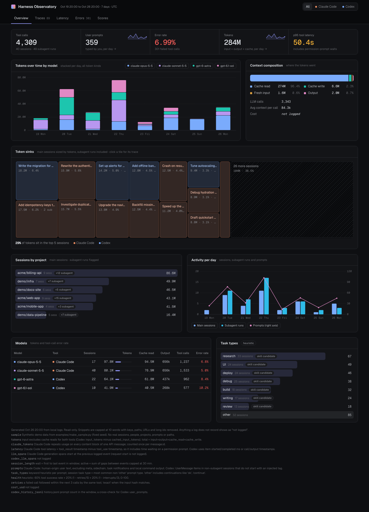
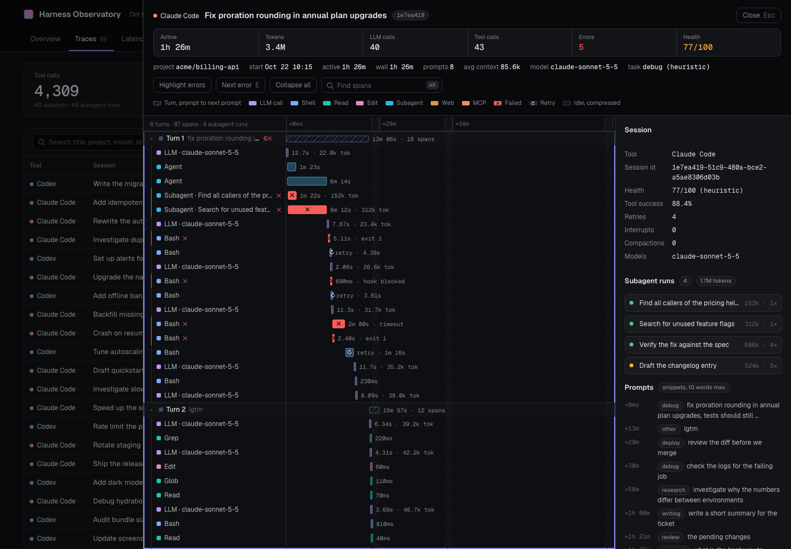
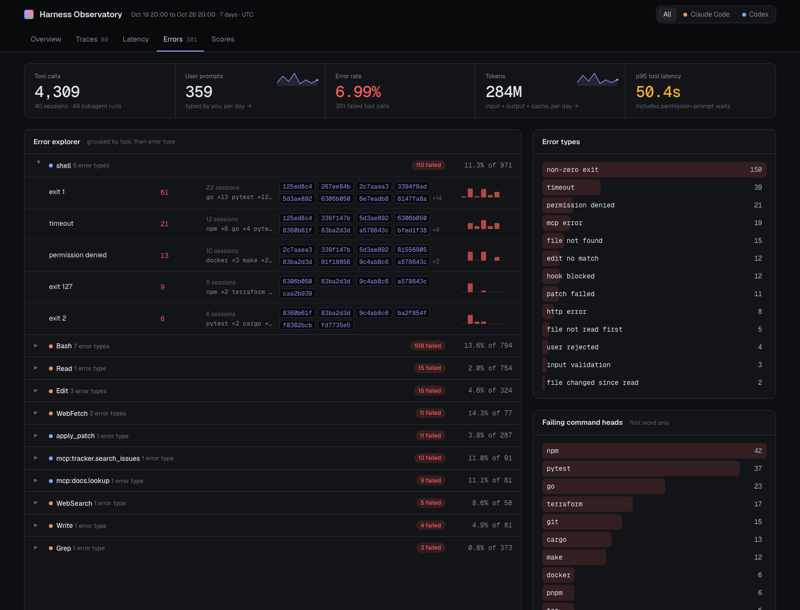
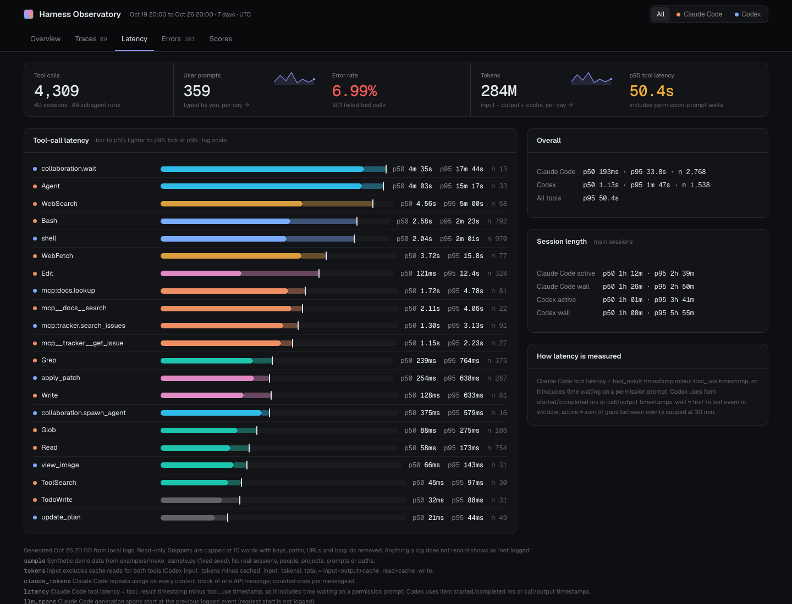
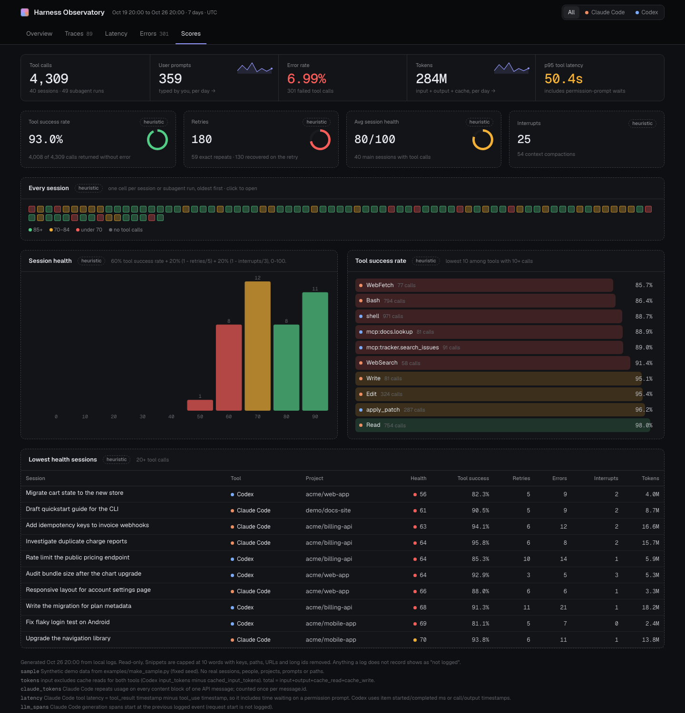

# Harness Observatory

A Langfuse-style observability dashboard for your own AI coding sessions, built from the logs Claude Code
and Codex already write on your machine. No server, no account, no dependencies: one stdlib Python script
reads the logs, and one HTML file shows them.



*Screenshots use the synthetic data in `examples/`, not real sessions.*

## What you get

- **Summary strip**: tool calls, prompts, error rate, tokens and p95 tool latency, with daily sparklines.
- **Traces**: one row per session, with search, task filter, sort and subagent nesting. Click a row to open
  a waterfall of turns, LLM calls, tool calls and subagent lanes. Failed spans are marked ✕ and retries ↻.
- **Overview**: tokens by model over time, context composition, a token-sink treemap, projects, task types
  and a model table.
- **Latency**: p50 and p95 per tool on a log scale, plus session length.
- **Errors**: failures grouped by tool and error type, with the sessions behind each and a 7-day trend.
- **Scores**: tool success, retries and per-session health, all labelled `heuristic`.
- **HARNESS.md**: a weekly proposal for your CLAUDE.md / AGENTS.md (model routing, tools to keep, fix or
  cut, skills, guardrails, token budget), citing the sessions behind every line.

| | |
|---|---|
|  |  |
|  |  |

## Quick start

```sh
git clone https://github.com/Nainish-Rai/harness-observatory.git
cd harness-observatory
python3 -I skills/harness-observatory/scripts/harness_summary.py      # reads logs read-only, writes harness-summary.json
python3 -I skills/harness-observatory/scripts/render_dashboard.py     # writes dashboard.html
open dashboard.html
```

Options: `--days 14` for a longer window; `--max-traces 200` caps the embedded traces; `render_dashboard.py
--max-mb 8` trims the file size. To see the dashboard without your own data, open `examples/demo.html`.

`harness-summary.json` and `dashboard.html` contain your session data and are ignored by git. Keep them local.

## As a skill

```sh
ln -s "$PWD/skills/harness-observatory" ~/.claude/skills/harness-observatory
```

Then ask Claude Code "refresh my harness dashboard" or use the prompts in [`prompts/`](prompts/):
[`weekly-review.md`](prompts/weekly-review.md) for the weekly loop, and
[`build-from-scratch.md`](prompts/build-from-scratch.md) for the original prompt this repo was built from.

## What it reads

| Source | Path | Used for |
|---|---|---|
| Claude Code | `~/.claude/projects/**/*.jsonl` (+ `subagents/agent-*.meta.json`) | sessions, turns, tools, tokens, subagents |
| Codex | `~/.codex/sessions/**/*.jsonl` | sessions, commands, MCP calls, patches, tokens |
| Codex | `~/.codex/history.jsonl`, `~/.codex/session_index.jsonl` | prompt cross-check, session titles |

Privacy: prompt text never leaves the script except as snippets of at most 10 words, with keys, paths, URLs,
emails and long ids stripped. Values the logs don't record are shown as `not logged`; cost in dollars is one
of them.

## Caveats

- Task types are a keyword heuristic, and health is a heuristic score. Both are labelled as such.
- Exit-code errors include harmless ones, for example `rg` with no match.
- Claude Code tool latency includes time spent waiting on permission prompts.

## Layout

```
skills/harness-observatory/
  SKILL.md                       how an agent runs it
  scripts/harness_summary.py     log analyzer (stdlib)
  scripts/render_dashboard.py    injects the JSON into the template
  scripts/check_tokens.py        design-token lint for the template
  assets/dashboard.template.html the single-file dashboard
examples/                        synthetic data generator, sample JSON, demo.html
prompts/                         ready-to-paste prompts
docs/screenshots/
```

The look comes from [observatory-ui](https://github.com/Nainish-Rai/observatory-ui), the design system,
layout and UI skill extracted from this dashboard.

## License

MIT
